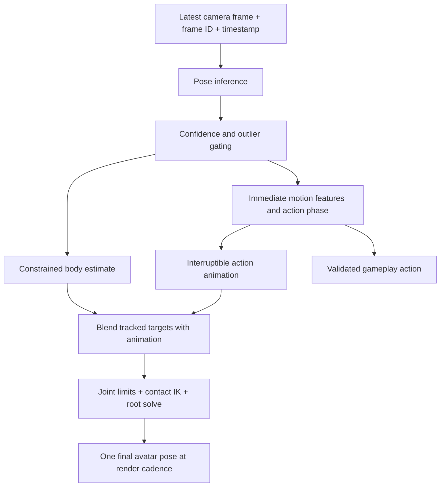

# FitFight motion replication: analysis and implementation plan

Current execution update (30 September 2026): [reviewed full-body plan](Full-body-avatar-mimicry-plan-reviewed.md) corrects the new proposal against this checkout and tracks the first implementation milestone. The analysis below is historical context.

Prepared 26 September 2026 from the current project source and primary Unity/tracking references.

**Recommendation:** use a hybrid controller: promptly follow reliable observed motion, recognize the beginning and phase of a small set of actions, and use authored animation plus constrained inverse kinematics to fill in ambiguous motion. Optimize camera/inference age separately. This is a better match for a responsive fighting game than trying to copy every noisy landmark exactly.

## Latest target clarification: practice.mp4

The subsequent reference `/Users/jotit/Desktop/practice.mp4` is accessible: approximately 8.08 seconds, 720×1280. Its avatar was examined across the clip and in a denser kick sequence. As requested, the bottom camera feed was disregarded for synchronization and fidelity assessment. The reference establishes a desired visual behavior; it does not establish how that behavior was generated or its real input latency.

**Feasibility judgment:** comparable visual smoothness and coordinated punch/kick behavior are realistic for a bounded move vocabulary using an animation-led hybrid controller. Reliable, responsive camera input across people and devices still needs a prototype and measurements. Smooth animation can run at render cadence even with slower pose observations, but slow observations still delay gesture recognition and cancellation.

The important visible qualities are coherent guard poses, coordinated torso/arm movement during punches, leg chamber/extension/recovery during kicks, support-leg behavior, and returning to a usable stance. Bag response reinforces the perceived impact. These qualities can be authored into clips and maintained between camera observations; independent landmark-to-bone aiming need not produce the main attack pose.

This clarification **changes the delivery order below**. The earlier overhead-direction regression remains useful for diagnosing the current mirroring path, but fixing every monocular reconstruction error is no longer a prerequisite for this game mode. Use reliable image-space/body-relative motion features to drive actions, bypassing ambiguous reconstructed depth where possible.

Revised prototype sequence:

1. **Prove the animation quality with deterministic controls.** Create a small controller for left/right punches and left/right kicks, using the existing clips where their quality is sufficient. Add phase-aware transitions, guard recovery, support-foot handling and synchronized bag contact. Trigger initially with buttons or recorded action events so tracking cannot obscure animation defects.
2. **Connect camera intent.** Recognize hand departure/extension and knee lift/foot extension using normalized, confidence-gated features and real observation timestamps. Start a reversible preparation response as evidence arrives. Commit only when the trajectory supports a strike. Do not require a complete gesture or a fixed long observation window before responding.
3. **Preserve useful control.** Let side/type, coarse height, speed and strength influence bounded animation parameters. Keep modest lean/duck continuously controllable. Squat depth follows descent/hold/ascent. Foot placement, joint geometry and attack recovery remain the controller's responsibility. Choose broad reliable action classes before attempting detailed technique classification.
4. **Define cancellation by phase.** Before commitment, a withdrawal returns smoothly to guard. During extension, contradictory evidence selects a plausible shortened recovery rather than snapping bones or freezing the clip. After a validated hit, retraction cannot undo the impact. Short occlusion may preserve a committed action; it cannot start another one.
5. **Measure agency as well as appearance.** Test missed/phantom strikes, wrong-side recognition, double triggers, aborted moves, combinations, tracking loss and sustained device load. Use the same animation controller for deterministic and camera inputs so responsiveness failures can be isolated.

Use one final pose owner. Its graph combines the current action/guard animation, small continuous tracking offsets, then constrained contact corrections. For bag contact, use bounded reach adjustment to the actual bag surface and one validated contact event per attack; avoid pulling the avatar's hand indefinitely after a swinging bag. The bag should respond to actual validated contact, rather than every classification event.

Unity provides animation clip mixing through [Playables](https://docs.unity3d.com/6000.0/Documentation/Manual/Playables-Examples.html), and limb target/hint controls through [Two Bone IK](https://docs.unity3d.com/Packages/com.unity.animation.rigging@1.3/manual/constraints/TwoBoneIKConstraint.html). These are suitable building blocks; the recognition, phase policy, joint limits and integration remain project work. A large motion-matching database is optional for a later, broader movement vocabulary.

The main design tradeoff is explicit: the player controls the intended action and useful variations, while the game supplies much of its full-body execution. Confidence in achieving the visual target is higher than confidence in a particular end-to-end latency before device testing. The reference's camera feed is not used to claim either input accuracy or latency.

**Original sample review update:** `sample camera capture.mp4` became accessible on retry and has now been examined through timestamped frames spanning its 33.128 seconds, with denser sequences for kicks, body motion, overhead arms and tracking loss. The recording visibly reports **TRACKING LIVE · RTMPose**. Saved settings, direct-versus-puppet mode and build revision are not shown. No calibration sequence is visible, so its execution/settings cannot be independently verified from this clip. No runtime code was changed for this analysis.

## What the supplied video establishes

The clearest failure is **movement being transformed into a different movement**, rather than merely arriving late. At **22.844 seconds**, the person and green landmark overlay both show hands above the head, while the avatar has both arms extended approximately forward at shoulder level. Similar overhead-to-forward mismatches recur around 22.75–23.25 and 24.25–24.75 seconds. The consistent wrong direction makes simple latency an insufficient explanation. See [native frame](VideoReview/overhead-22.844.png) and [arm sequence](VideoReview/arms-20-25s.jpg).

| Approximate interval | Visible evidence | Interpretation and next check |
|---|---|---|
| 4–9 s | Leg lifts/kicks do reach the avatar, but the avatar cycles through strongly bent chamber poses and extension with uneven correspondence to the small camera view. | The leg pipeline is active. Check depth branch selection, knee bend planes and phase timing, rather than treating this as complete leg detection failure. The small preview does not justify precise joint-angle measurements. [Sequence](VideoReview/kicks-4-9s.jpg) |
| 13–18 s | Forward body dips produce pronounced coupled changes in avatar torso, knee and foot placement; the response returns abruptly toward a straighter stance between dips. | Consistent with reconstruction/contact coupling and uneven response. This does not isolate whether raw landmarks, filtering or final pose composition introduce each change. [Sequence](VideoReview/body-13-18s.jpg) |
| 20–25 s | Repeated overhead reaches are represented mainly as forward reaches; the green overlay can show the overhead arm shape while the avatar does not. | Strongest evidence for prioritizing the path after 2D detection: camera correction, depth reconstruction, coordinate conversion and retargeting. A constrained solver must preserve the correct target direction, not merely make the wrong pose anatomical. [Sequence](VideoReview/arms-20-25s.jpg) |
| 29–33 s | The person approaches the camera; the avatar briefly raises a knee. Once full-body visibility is lost, the UI requests stepping back and the avatar remains in a low, bent fighting stance. | Full-body loss is recognized. Whether the remaining stance is the intended authored guard or undesirable retained motion requires final-pose/state logs; the video alone does not establish that it is a frozen tracking pose. [Sequence](VideoReview/tracking-loss-29-33s.jpg) |

The camera is visibly placed low and looks upward. That makes the current approximate floor-camera perspective correction especially relevant. The visible 2D overlay is useful evidence that some arm geometry survives detection; it is not a ground-truth 3D skeleton or proof that every confidence score is acceptable.

**Revised first regression:** replay arms-down → forward reach → overhead reach → arms-down, including an overhead hold, with the final avatar filmed from front and side. Log raw 2D endpoints, rectified coordinates, inferred depth, filtered endpoints and final bone directions. Compare the established puppet and direct modes on identical observations; ablate floor correction and depth priors independently. Use the held overhead pose to distinguish directional mapping errors from delay. Add matching upright/side-bend/knee-lift poses before adding action assistance. Animation completion should not conceal this elementary mapping failure.

**Latency limits of this evidence:** this is a 392×850 variable-frame-rate screen recording containing a small camera thumbnail and the avatar, not an external recording of the physical person and display. It can show relative phase errors, movement loss and visual discontinuities. It cannot determine physical motion-to-display latency or uniquely separate camera-preview age from pose age. The file has 1,373 video frames, averaging about 41.4 encoded frames/sec; that is neither measured pose FPS nor guaranteed game render FPS. Contact sheets sample at 4 Hz (tracking-loss sheet at 2 Hz), so their timestamp labels are sampling bins rather than exact event-onset measurements. The native overhead still retains its source presentation timestamp.

The clip does not cleanly establish small-jump replication or provide sufficient head detail for a neck-jitter measurement. Those remain explicit tests in the proposed capture protocol. Video evidence strengthens the priority of coordinate/depth correctness, coherent retargeting and contact states; it does not prove inference is the dominant timing cost on this particular run.

## Findings in the current implementation

| Finding and source | Consequence | Priority |
|---|---|---|
| `RTMPosePoseProvider.cs:219–269` schedules one inference at a time, drops incoming frames while busy, and uses asynchronous readback. It already consumes results in Update and LateUpdate. | A growing inference queue is already prevented. “Make inference asynchronous” is not a new solution. Measure actual scheduling, GPU completion and delivery delays. | P0 measurement |
| `BodyTracking/TUNING.md` records a previous SM-S928B check at roughly 9–13 inference FPS and 69–109 ms frame-available-to-result time. Referenced raw logs are absent from this checkout. | Historical documentation suggests a substantial acquisition/inference bottleneck. These figures are not measurements of this session or the missing video. A 60 FPS render loop does not provide 60 independent pose observations. | P0 measurement |
| `Skeleton25DSolver.cs:90–95,162–204` infers depth from projected limb shortening, generally assumes the toward-camera branch, and changes shin depth branch based on ankle drop. | Forward/backward ambiguity and incorrect depth can generate plausible-looking coordinates with incorrect knees/elbows. The branch transition is heuristic, not an anatomical constraint. | P1 replace reconstruction assumptions |
| `Skeleton25DSolver.cs:167,224` filters bone vectors before depth estimation and then filters reconstructed joints again. `PoseSolution.cs:41–42` bypasses the older modifier smoothing for RTMPose. | Avoid blaming the bypassed legacy filter. There are still two internal temporal stages whose combined onset delay needs ablation. Pre-depth filtering has a valid noise-control purpose. | P1 measure and consolidate |
| `RTMPoseMath.cs:104–116` uses an anchored dead zone before adaptive smoothing. Default radius is 1.8 cm, rises toward 3.6 cm at weak confidence, and reaches full response at three times the radius. | Small intended movements can be attenuated over a substantial range, especially after two filtering stages. These are solver-space distances, not measured physical accuracy. | P1 per-joint tuning |
| `DirectHumanoidRetargeter.cs:83–96` independently aims bones using `FromToRotation`. `AvatarSkeleton.cs:171–179` directly writes world rotations. | Bone lengths are preserved by the avatar hierarchy, but coupled joint limits, elbow/knee bend planes and axial twist are not solved. A valid humanoid import does not constrain these direct writes automatically. | P1 constrained retargeting |
| `BodyMotionEstimator.cs:29–38` estimates forward bend from torso contraction and sets torso yaw to zero. `Skeleton25DSolver.cs:153–159` constructs stabilized shoulders/hips. | Calibration cannot recover natural punching torso twist in this mode; some movement loss is structural. Forward bends are ambiguous estimates, not measured 3D. | P1 torso model |
| `Skeleton25DSolver.cs:117–139` subtracts hip center; direct retargeting writes rotations rather than tracked root translation. | The controller needs a separate pelvis/root signal to distinguish squat, jump and whole-body image motion. Common vertical translation has been removed from this path. | P1 root/contact model |
| `FitFightFighterGrounding.cs:61–100` translates the entire avatar so its lowest shoe touches the floor, in either vertical direction. | When configured and running, this prevents genuine airborne motion. It also couples noisy shoe geometry to root height. | P1 jump/contact fix |
| Grounding invokes shoe `BakeMesh` in LateUpdate and additionally via camera pre-cull callbacks where those callbacks fire. | Possible CPU cost and repeated correction, not a measured bottleneck. Profile; prefer calibrated sole points and one pose-stage contact solve. | P1 profile |
| `FitFightGuardPose.cs:58–123` evaluates a separate guard graph and restores live rotations when body parts are missing; grounding then runs at order 9500. | These are coordinated existing fallbacks, not proof of uncontrolled competing writers. Nevertheless, final displayed pose can differ from retargeter output. Instrument all stages and consolidate ownership. | P1 composition |
| `BodyTrackingDiagnostics.cs:48–60` writes aggregate CSV samples every 0.1 seconds. | It cannot explain an individual failed punch: no raw landmarks, ROI, per-joint states, animation phase or final bone pose. | P0 recorder |

The legacy MediaPipe route also exposes internal landmark smoothing in `MPUPoseTrackingSolution.cs`, followed by app-side modifiers. Instrument that route too; do not assume its latency is identical to RTMPose. Runtime engine selection and saved PlayerPrefs must be captured, rather than inferred from project defaults.

## Architecture to build

Keep the existing camera ownership, provider abstraction, mirrored coordinates, local/opponent separation and no-backlog scheduling. Introduce the new controller behind an A/B option. Confidence, freshness and whether a value is observed, predicted, animation-assisted or held must travel with the data.

The feature branch should use lightly filtered, outlier-checked observations before heavy display smoothing. The display branch should maintain a coherent articulated pose. Multiple render evaluations of one observation must never count as new action evidence.

### Anatomical stability and contacts

Use the avatar's imported segment lengths, rig-specific joint axes and a calibrated neutral pose. Start with a bounded analytic two-bone IK solve per limb, reliable elbow/knee pole directions, and pelvis/spine composition. Add a small fixed-iteration coupled solve only where replay shows it is needed.

- **Elbows and knees:** hinge-like bending with configurable flexion bounds, no reverse bending or knee sideways swivel; preserve the previous bend plane near full extension. Forearm pronation is a separate twist degree of freedom. Avoid Euler clamps in world coordinates.
- **Shoulders and hips:** local swing/twist envelopes and bounded reach; include clavicle motion and torso contribution so long punches do not force distorted shoulders. Add simple limb-versus-torso collision proxies to reduce arms passing through the chest.
- **Spine and pelvis:** distribute bend and twist across the chain, rather than repeating the same local rotation at each joint. Treat hip flexion and spine flexion separately. Allow lateral bends. Use animation priors for depth ambiguity, with reliable observations controlling direction and amplitude.
- **Neck and head:** solve head motion relative to chest, with rig-specific swing/twist bounds and smooth limits. Sparse face landmarks should have less authority when occluded. Share turns between neck and head; do not force the head to inherit every torso rotation.
- **Feet:** estimate left/right contact states independently using height, velocity, support history and confidence. Lock only the supporting foot; release before a kick or takeoff. A missing ankle is “unknown,” not proof of contact or flight.
- **Root:** retain image-space hip translation before normalization. During a squat, lower the pelvis while both foot contacts remain fixed. During a kick, stabilize the support leg and permit controlled weight shift. During a jump, release both floor constraints, use a bounded vertical arc, then blend into landing flexion.
- **Loss/reacquisition:** transition through tracked, briefly held and fallback states with hysteresis. Blend back from the actual displayed pose. Missing data must not repeatedly restart an action.

Limits are configurable animation constraints for these rigs and actions, not universal human anatomical measurements. Validate them visually on Adam and Remy, including near-straight limbs, crossover poses, twists and low-camera views. Solve constraints after animation blending so the final pose also satisfies them.

Unity's Two Bone IK supplies target and bend-hint control; it is a building block rather than a complete anatomical solver. Use custom joint-limit/contact jobs where necessary. [Unity Two Bone IK](https://docs.unity3d.com/Packages/com.unity.animation.rigging@1.3/manual/constraints/TwoBoneIKConstraint.html).

### Movement onset and animation assistance

The user's proposed “detect the beginning and complete with animation” is appropriate, with continuous correction and cancellation. No causal controller can know the intended action before sufficient visual evidence arrives. At 10 pose FPS, waiting for two new observations adds about 100 ms; a classifier cannot fix that acquisition limit.

Move the avatar immediately from available evidence. Begin with a low-commitment anticipation pose, then increase action animation weight as evidence accumulates. Use a causal state machine first: idle/guard → candidate → committed → recovery, with reversal/cancellation paths. Estimate phase, side, direction, amplitude and speed, not only an action label. Distinguish torso motion from wrist/ankle motion in body-relative features.

| Movement | Early evidence | Assisted result and cancellation |
|---|---|---|
| Straight punch / hook | Wrist velocity relative to shoulder, elbow opening or lateral arc, guard departure, torso rotation cues | Blend a matching clip from the estimated current phase; preserve hand target and speed. Withdraw assistance on retraction or contradictory trajectory. Do not wait for full extension. |
| Front / side kick | Knee lift, foot acceleration, hip geometry and support-foot evidence | Blend chamber, extension and recovery with support-leg IK. A raised knee alone remains a chamber, not a committed kick. |
| Squat | Bilateral knee flexion and pelvis descent relative to stable feet | Continuous depth-controlled squat blend; maintain the user's bottom hold and reversal rather than playing a fixed-duration cycle. |
| Small jump | Upward pelvis/ankle motion, preparation and evidence consistent with both feet leaving support | Trigger a small bounded takeoff/flight/landing sequence; compare against heel raise and camera movement negatives. Never infer takeoff solely from lost feet. |
| Forward / side bend | Torso orientation and shoulder-to-pelvis geometry with support maintained | Continuous bend/lean blend; avoid turning every torso contraction into a squat or forward bend. |

Start phase-matched playback rather than restarting clips at frame zero. Blend using pose and velocity continuity; support interruption and simultaneous actions through masks. For example, a punch can coexist with a small squat, but two contradictory whole-body clips should not fight over the pelvis. A jump/contact state takes precedence over planted-leg corrections.

The project already contains `leftHookAnim.fbx`, `rightHookAnim.fbx`, `LeftKickAnim.fbx`, `RightKickAnim.fbx`, `AirSquatAnim.fbx` and an idle in `Assets/Tracking4All/Models/FitFight/Animations`. Reuse them after inspecting clip quality, handedness, root motion, contact timing and rig retargeting. Their presence does not establish their suitability. Straight punches, a small jump and bend poses may need additional animation assets.

For gameplay, define an explicit contract: once sufficient real motion commits an assisted attack, it can drive a bounded game attack with a clip-based contact window. Anticipation, held landmarks and visual prediction alone cannot create a scored hit. Retain strict measured-contact mode as the comparison baseline. Update practice-bag and multiplayer logic to consume validated action IDs/phase instead of accidentally scoring cosmetic animation; one action ID can score at most once per intended target/contact policy.

### Latency work

First separate camera sampling/exposure, driver delivery, frame scheduling, preprocessing, inference, readback, pose solve, composition and display. Current `LastInferenceMs` includes time from frame availability to result consumption; it is not pure neural compute time. Direct avatar age is not physical movement-to-photon latency either.

Preserve asynchronous readback and latest-frame scheduling. Profile GPU contention with the game running; compare an inexpensive render scene to the normal scene and profile shoe baking. A/B test the existing MediaPipe model options and RTMPose on the target phone using identical motion and effective camera settings. Test 30 versus 60 requested FPS while recording actual cadence and camera exposure behavior. Benchmark after warmup and after ten minutes.

If inference remains around the historical 70–110 ms, model/backend optimization is essential. Evaluate a smaller supported model or native accelerated deployment as a separate measured experiment; do not assume ONNX/Unity GPU compute uses the phone's NPU. Model conversion, delegate support and quantization require accuracy and compatibility checks. OpenMMLab supplies deployment/model options but its published benchmarks do not establish FitFight performance. [RTMPose project](https://github.com/open-mmlab/mmpose/tree/main/projects/rtmpose).

Make pose consumption and final application an explicitly ordered stage, using the newest complete observation. Preserve short bounded extrapolation and cancel at stops/reversals. The existing 40 ms horizon cannot erase a 100 ms observation delay; extending it to a whole punch would amplify wrong predictions. Treat action assistance as a separate semantic mechanism.

Measure the two RTMPose filter stages separately. Keep noise suppression around depth reconstruction where needed, but avoid unnecessary repeated smoothing after a constrained solve. Tune by body part, motion state and confidence: planted feet need more stabilization than a striking wrist. The One Euro method explicitly trades rest stability against movement lag; tune using rest and onset recordings together. [Filter authors](https://gery.casiez.net/1euro/).

## Minimal experiment and replay package

Build this before another round of subjective tuning. One initial participant and one target phone are sufficient to locate bottlenecks, not to establish general accuracy.

**Record a roughly three-minute session:** 15 seconds neutral/guard; 30 seconds punches; 35 seconds front/side kicks; 20 seconds squats including a hold; 15 seconds small jumps; 20 seconds forward/side bends; 25 seconds aborted punches/kicks, raised knees, crossed arms and brief occlusion; 20 seconds casual movement, stepping away and reentry. Cover left/right and slow/fast trials. Mark the intended action separately from model predictions.

Use one setup in good light with the whole body and extended limbs visible. Repeat at the actual low camera placement after the first comparison; avoid changing camera angle, engine and filtering simultaneously. Capture calibration and settings explicitly. Later use held-out sessions from at least several different people and body proportions; tune on one set and evaluate on another.

Proposed capture bundle:

| Artifact | Contents |
|---|---|
| `session.json` | Build/source fingerprint, engine/model hash, device/OS, camera, actual dimensions, orientation/mirroring, requested FPS, full effective tuning, calibration, rig, timing units and schema version |
| `camera.mp4` + `frames.csv` | Same camera stream used by inference; video PTS ↔ source frame ID ↔ monotonic frame-available timestamp. Record inference-consumed IDs and skipped frames. A screen recording alone is insufficient for raw-model replay. |
| `observations.jsonl` or equivalent binary | One record per actual inference result: source ID, ROI, raw keypoints/scores, world keypoints if supplied, all stage times, acceptance/rejection reasons, model index mapping |
| `poses.jsonl` or binary | Filtered targets, reconstructed pose, joint status/age, action state/phase/weight, contact states and root; final local bone rotations and root once per rendered frame, plus the source observation ID |
| `events.csv` | Human action labels, onset/apex/return, cancellation, calibration events, valid game hits and their action IDs |
| Optional external high-speed video | The person and physical phone display in the same view, for actual motion-to-display delay |

Use pooled buffers and a bounded background writer. Do not block inference for video encoding or stringify large arrays every frame. Log recorder queue drops explicitly and compare instrumentation on/off overhead. Use camera timestamps where the native API exposes them; otherwise label Unity's timestamp as **availability**, not exposure. Keep video PTS and monotonic-clock mapping with repeated sync markers so drift can be detected. A visible frame counter/sync patch can align external display video to the software trace.

Record both exact inference input frames and enough source video to rerun the model; sparse input frames alone cannot test higher inference cadence. For deterministic solver replay, raw landmarks plus original timestamps are sufficient. For model comparison, rerun the same raw video with the same orientation/ROI policy and log differences. For device speed, use live capture: offline replay alone does not benchmark the camera or display.

Replay should show camera, raw skeleton, filtered/constrained skeleton and final avatar together, with a scrubber and source-frame age. A stationary screenshot can reveal bad joint geometry; it cannot measure latency. Compare motion onset, stop, reversal and peak excursion, not just periodic-motion cross-correlation.

Run these ablations on the same capture: current effective settings; current direct versus puppet; prediction off; each filter stage reduced separately; constrained retargeting; constrained retargeting plus action assistance. Use online trials for physical latency and replay for solver quality. Include negatives so better action recall cannot hide phantom punches.

## Success criteria and delivery order

These are proposed engineering targets, not achieved results or device guarantees. Report distributions and per-action results rather than only averages.

| Measure | Initial acceptance target |
|---|---|
| Independent pose cadence | Sustained ≥30 Hz on the target device; report stalls and worst cadence after thermal soak |
| Frame available → final pose | Median ≤50 ms, p95 ≤80 ms |
| Physical movement → first corresponding avatar movement | Median ≤100 ms, p95 ≤150 ms, measured externally; separately report commitment and peak timing |
| Render cadence | Sustained 60 FPS where supported; investigate p95 frame time above 20 ms |
| Stillness | Illustrative starting gates: wrist/ankle RMS jitter ≤1–2 cm in avatar space, head/torso ≤1–2°; report amplitude retention so a frozen avatar cannot pass |
| Geometry/contact | Zero configured hard-limit violations or reverse knee/elbow bends in the regression set; planted-foot drift <2 cm per second; no visible floor penetration above a rig-scaled tolerance |
| Action recognition | ≥95% recall on held-out intended actions, ≤1 phantom action per minute of varied negatives; report side/type confusion and uncertainty from sample counts |
| Interruption | Visual response within one new accepted observation plus one render frame; p95 ≤100 ms is a target once cadence improves |
| Jumps and squats | All prescribed jumps visibly airborne; squat depth follows descent/hold/ascent; heel raises and lost ankles do not become jumps |

The three-minute session is a diagnostic fixture, too small to substantiate all recognition targets. Extend held-out positive and negative testing before declaring readiness. If 30 Hz or physical latency targets fail, prioritize capture/inference changes instead of concealing delay with increasingly aggressive animation prediction.

1. **P0 — Evidence and replay.** The supplied video review is complete above. Add `MotionCaptureRecorder`, shared timestamped observations for both engines, and a replay viewer. Capture effective configuration and final pose. Start with the overhead-to-forward failure at 22.844 seconds and a held-pose regression. Exit: each failure can be assigned to input, filtering, reconstruction, retargeting, contacts or display.
2. **P1 — Coherent body and contacts.** Add `ConstrainedHumanoidSolver`, `FootContactEstimator` and one `AvatarPoseComposer`. Preserve root observations, replace always-grounded shoe correction, introduce joint limits and bend-plane continuity, and consolidate guard fallback. Exit: stable standing, correct squat/airborne states and no impossible bends in replay.
3. **P1 — Measured latency reduction.** Optimize the largest timed stages, compare engines/backends, reduce redundant temporal filtering and repeated pose work. This can begin after P0 while the solver is developed. Exit: target cadence and latency, or a documented device/backend limitation.
4. **P2 — Action assistance.** Add `MotionIntentEstimator`, phase annotations for existing clips, and an interruptible `AssistedActionPlayer`. Implement punches/kicks first, then continuous squat/bends and jump. Integrate explicit action events with bag and multiplayer validation. Exit: more complete recognizable moves without phantom attacks or loss of user control.
5. **P3 — Generalization.** Test multiple people, lighting, camera elevations, both avatars and thermal conditions. Only add a small causal learned classifier or a larger motion-matching database if measured errors justify the extra data and complexity.

## Unity examples to borrow from

Use the existing FitFight clips and guard Playables integration as the first reusable assets. For external examples, borrow mechanisms rather than assuming a ready-made game solves front-camera body tracking:

- [Unity animation jobs samples](https://github.com/Unity-Technologies/animation-jobs-samples): examples of layered blending, two-bone IK and full-body IK. Treat these as implementation references and validate adaptations against this project's installed Unity/package versions.
- [JLPM22 MotionMatching](https://github.com/JLPM22/MotionMatching): Unity motion matching, inertial blending and foot-locking examples. Useful if the action library expands; a small phase-driven clip set is simpler for the present move vocabulary. This is not a camera intent detector.
- [MotionMatching Animator integration](https://joseluisponton.com/motionmatching-docs/advanced/unity_animator/): reference for joint masks and smooth pose transitions between animation systems.
- [Unity Twist Correction](https://docs.unity3d.com/Packages/com.unity.animation.rigging@1.3/manual/constraints/TwistCorrection.html): distribute twist along a chain; it does not resolve unobservable twist from 2D landmarks.
- [Unity asynchronous inference output](https://docs.unity3d.com/Packages/com.unity.ai.inference@2.6/manual/read-output-async.html): confirms the distinction between asynchronous readback and blocking tensor access. The existing RTMPose path already implements asynchronous readback.

The decisive change is to represent a body, its contacts and its current action coherently, then use landmarks as uncertain observations of that state. Calibration and stronger smoothing alone cannot add absent root motion, torso twist, anatomical constraints or faster camera observations.
